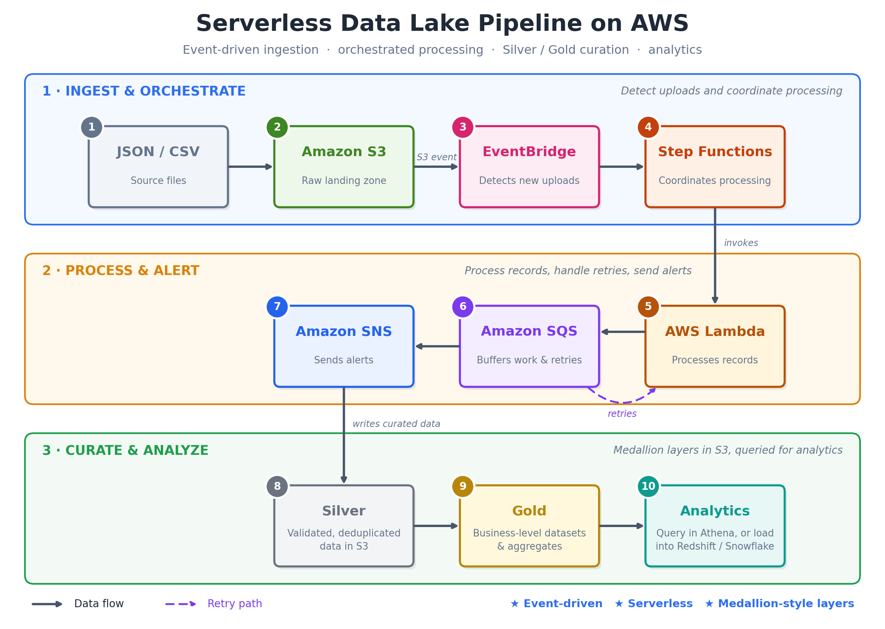

  
  
  
  
  
  
  
  
  

<h1 align="center">Serverless Data Lake Pipeline on AWS</h1>

  An event-driven, serverless data pipeline that detects JSON/CSV uploads in
  <b>Amazon S3</b>, coordinates processing with <b>EventBridge</b> and
  <b>Step Functions</b>, handles records, retries, and alerts with <b>Lambda</b>,
  <b>SQS</b>, and <b>SNS</b>, and curates the data into <b>Silver</b> and <b>Gold</b>
  layers for analytics in <b>Athena</b>, <b>Redshift</b>, or <b>Snowflake</b>.

  
  
  
  

---

## Table of Contents

- [Overview](#overview)
- [Architecture](#architecture)
- [Pipeline Stages](#pipeline-stages)
- [Data Layers](#data-layers)
- [Tech Stack](#tech-stack)
- [IAM & Permissions](#iam--permissions)
- [Setup](#setup)
- [Reliability & Alerting](#reliability--alerting)
- [Analytics](#analytics)
- [Roadmap](#roadmap)
- [License](#license)

---

## Overview

Raw JSON and CSV files land in S3. An S3 event picked up by EventBridge starts a Step
Functions workflow, which coordinates Lambda-based record processing. SQS buffers work
and supports retries, and SNS sends alerts when something needs attention. Validated,
deduplicated data is written to a **Silver** layer in S3, then refined into **Gold**
business-level datasets and aggregates that are queried with Athena or loaded into
Redshift or Snowflake.

## Architecture

  
  

## Pipeline Stages

| # | Stage | Service | Role |
|---|---|---|---|
| 1 | Source | JSON / CSV files | Incoming data files |
| 2 | Landing | Amazon S3 | Raw landing zone; emits an event on upload |
| 3 | Detect | Amazon EventBridge | Detects new uploads from the S3 event |
| 4 | Orchestrate | AWS Step Functions | Coordinates the processing workflow |
| 5 | Process | AWS Lambda | Processes records |
| 6 | Buffer & retry | Amazon SQS | Buffers work and supports retries |
| 7 | Alert | Amazon SNS | Sends alerts |
| 8 | Silver | Amazon S3 | Validated, deduplicated data |
| 9 | Gold | Amazon S3 | Business-level datasets and aggregates |
| 10 | Analytics | Athena / Redshift / Snowflake | Query in place, or load curated data |

## Data Layers

| Layer | Contents | Location |
|---|---|---|
| Raw | Source JSON/CSV files as uploaded | S3 landing zone |
| **Silver** | Validated, deduplicated data | S3 |
| **Gold** | Business-level datasets and aggregates | S3 |

## Tech Stack

| Concern | Technology |
|---|---|
| Storage | Amazon S3 |
| Eventing | Amazon EventBridge |
| Orchestration | AWS Step Functions |
| Compute | AWS Lambda |
| Queueing | Amazon SQS |
| Notifications | Amazon SNS |
| Analytics | Amazon Athena, Amazon Redshift, Snowflake |
| Access control | AWS IAM |

## IAM & Permissions

Apply least privilege to each role. Typical permissions for this design:

| Role | Permission | Purpose |
|---|---|---|
| EventBridge rule | `states:StartExecution` | Start the workflow on a new upload |
| Step Functions | `lambda:InvokeFunction` | Invoke the processing Lambda |
| Lambda | `s3:GetObject` | Read raw files |
| Lambda | `s3:PutObject` | Write Silver / Gold outputs |
| Lambda | `sqs:SendMessage` / `sqs:ReceiveMessage` / `sqs:DeleteMessage` | Queue work and handle retries |
| Lambda / Step Functions | `sns:Publish` | Send alerts |
| Lambda / Step Functions | `logs:CreateLogGroup` / `logs:PutLogEvents` | CloudWatch logging |

## Setup

1. **Create the S3 bucket** with prefixes for raw, Silver, and Gold data.
2. **Enable S3 event delivery to EventBridge** on the bucket.
3. **Create the SQS queue** (and optionally a dead-letter queue) and the **SNS topic**; subscribe your email or endpoint to the topic.
4. **Deploy the Lambda function** that processes records and writes Silver / Gold outputs.
5. **Define the Step Functions state machine** that coordinates the Lambda step.
6. **Create the EventBridge rule** matching object-created events and targeting the state machine.
7. **Attach IAM roles** per the table above.
8. **Upload a JSON/CSV file** to the raw prefix and watch the execution in the Step Functions console.

## Reliability & Alerting

- SQS buffers work between steps so transient failures can be retried instead of lost.
- SNS sends alerts when processing needs attention.
- Test both the success and failure paths before relying on the pipeline.

## Analytics

Gold datasets can be queried in place with **Athena** where available, or the curated
data can be loaded into **Redshift** or **Snowflake** for warehouse-style workloads.

| Option | Approach |
|---|---|
| Athena | Query the Gold layer in S3 directly |
| Redshift | Load curated Gold data into the warehouse |
| Snowflake | Load curated Gold data via an external stage on the S3 Gold prefix and `COPY INTO` (or Snowpipe for continuous loading) |

## Roadmap

- [ ] Define the pipeline as infrastructure as code (Terraform, AWS SAM, or CDK)
- [ ] Add CloudWatch dashboards and alarms for execution failures and queue depth
- [ ] Add a dead-letter queue and replay tooling
- [ ] Add data quality checks and unit tests for the processing Lambda

  Built with S3 · EventBridge · Step Functions · Lambda · SQS · SNS · Athena / Redshift / Snowflake

